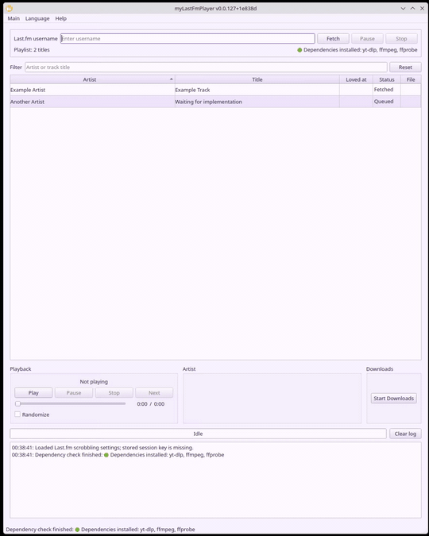
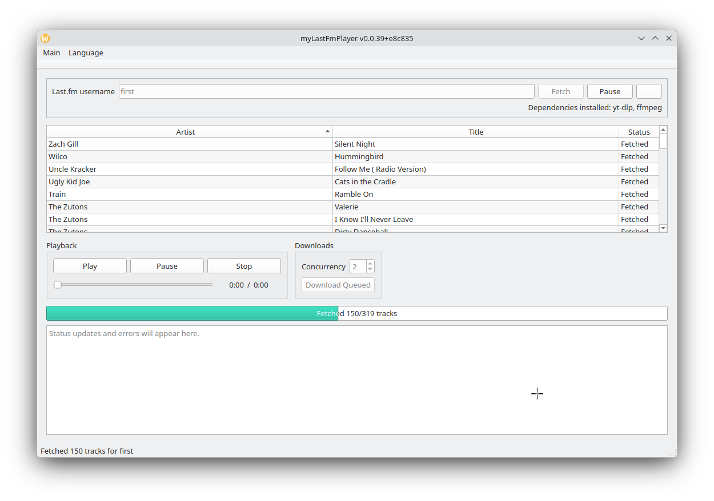
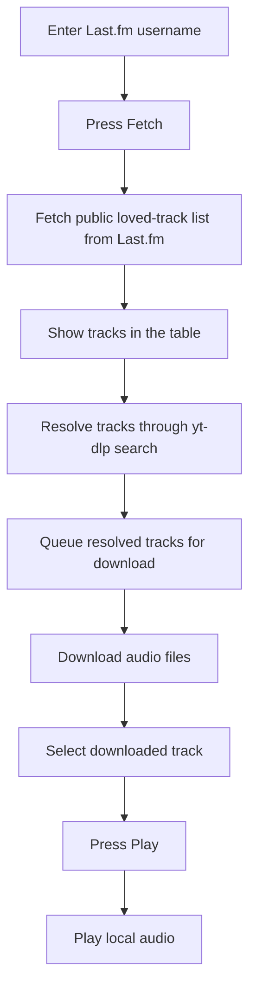
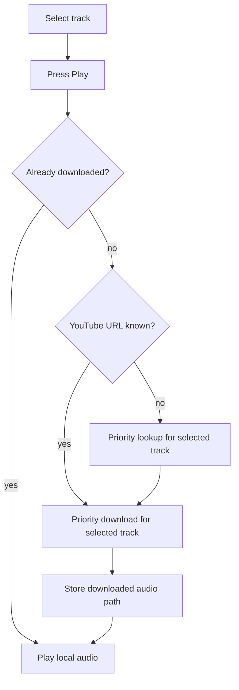

# myLastFmPlayer

[](https://github.com/marcelpetrick/myLastFmPlayer/actions/workflows/local-pipeline.yml)
[](https://github.com/marcelpetrick/myLastFmPlayer/actions/workflows/manual-release.yml)
[](https://github.com/marcelpetrick/myLastFmPlayer/releases/latest)
[](LICENSE)
[](https://www.python.org/)
[](https://www.riverbankcomputing.com/software/pyqt/)
[](pyproject.toml)

`myLastFmPlayer` is a fully functional, actively maintained Linux desktop product that
turns a Last.fm loved-track history into a local, playable music library. It discovers
tracks from Last.fm, finds playable sources through YouTube, downloads audio files, and
plays them locally from one PyQt6 interface.

**Author: Marcel Petrick <mail@marcelpetrick.it>**

**License: GPLv3 or later. See [`LICENSE`](LICENSE).**

**Note: project is generated with AI.**

## Product Status

Current version: `0.0.196` — fully functional and actively maintained

**New in 0.0.196:** right-click a track and choose **Unlove on Last.fm…** to remove
duplicate loves from your Last.fm account, after an explicit confirmation — see
[Unloving Tracks on Last.fm](#unloving-tracks-on-lastfm).

The complete intended workflow is implemented and used in practice. Its major features
are covered by the automated test suite, packaging and installed-application checks,
with opt-in live integration tests for Last.fm and `yt-dlp`. Development continues
through fixes, compatibility updates, usability improvements, and carefully scoped
extensions rather than completion of missing core features.

For detailed technical information, see the
[`documents/` documentation map](documents/README.md), the maintained
[`runtime architecture`](documents/03_ARCHITECTURE.md), and the generated
[`Sphinx documentation`](docs/index.rst).

## Major Features

- Fetches any user's public loved tracks through the Last.fm Web API.
- Shows partial results immediately while later Last.fm pages are still loading.
- Searches YouTube and downloads resolved tracks automatically through `yt-dlp`.
- Runs up to five YouTube checks and downloads concurrently, configurable from one to five.
- Keeps each track independent, so one failed lookup or download does not stop the queue.
- Shows independent Last.fm discovery, YouTube-check, and download progress.
- Lets the user stop active YouTube work, keep completed items, and resume the remaining queue.
- Lets the user switch Last.fm usernames while work is active, with clean cancellation and
  isolation from late background updates and stale progress.
- Prioritizes a selected track for lookup and download when Play is pressed before it is local.
- Plays local tracks with seek, volume, mute, next-track, and randomized continuation controls.
- Keeps long now-playing details available without widening the window and scrolls
  Preferences within the available screen at larger font sizes.
- Shows artist artwork with a link to the artist's Last.fm page.
- Retries transient lookup and download failures and rechecks unfinished work after startup.
- Explains per-track failures in tooltips and provides status-aware retry actions and filtering.
- Stores per-user libraries and caches locally and retains them across restarts by default.
- Supports optional authenticated Last.fm scrobbling.
- Unloves a track on Last.fm from the table's context menu after an explicit
  confirmation, which helps clean up duplicate loves.
- Includes light, dark, lilac, and mint themes plus English, Croatian, German, Mandarin,
  and Ukrainian interfaces.
- Supports keyboard-first operation with filter, playback, preferences, quit, seeking,
  retry, and artist-link access plus explicit accessible control names and label buddies.

## Interface

[](media/myLastFmPlayer_v0.0.127_recording.webm)

Click the preview to open the full recording.



## Versioning

The version is `MAJOR.MINOR.PATCH` without leading zero padding; the first release
was `0.0.1`. `my_lastfm_player/version.py` is the single source of truth, and
`pyproject.toml` reads the same `__version__`.

For this project, every future commit should increase the `PATCH` number unless the
change intentionally requires a `MINOR` or `MAJOR` bump.

Built packages append a build suffix - the first six digits of the git commit hash -
to the version shown in the startup line and window title. Source-tree runs show only
the base version. Contributor rules live in [`docs/agents.md`](docs/agents.md).

## Installation and Requirements

Download a wheel or source archive from the
[GitHub Releases page](https://github.com/marcelpetrick/myLastFmPlayer/releases), or install
from a source checkout. The application requires:

- Linux x86_64
- Python 3.14 or newer with `venv` support
- `yt-dlp`
- `ffmpeg` and `ffprobe`

On Manjaro, install the external tools with:

```sh
sudo pacman -S yt-dlp ffmpeg
```

### Install a Release Wheel

Create an isolated environment and install the downloaded wheel:

```sh
python3 -m venv .venv
source .venv/bin/activate
python -m pip install /path/to/my_lastfm_player-0.0.196-py3-none-any.whl
my-lastfm-player
```

### Run from a Source Checkout

Create the virtual environment:

```sh
python3 -m venv .venv
```

Activate it:

```sh
source .venv/bin/activate
```

Install the app in editable mode:

```sh
python -m pip install --upgrade pip
python -m pip install -e .
```

Run the app:

```sh
my-lastfm-player
```

Alternatively:

```sh
python -m my_lastfm_player
```

## Last.fm API Credentials

The app ships with Last.fm desktop application credentials so loved-track fetching
and scrobbling can work without every user registering a separate Last.fm API
account:

- API key: `d36dce7154716e08a1d2907b7badadf7`
- Shared secret: `ed22747b03cabe49ab93f7215afc06fc`

These are application credentials, not a user's Last.fm password or session key.
Public loved-track fetching uses the API key only. Last.fm's desktop
authentication flow for scrobbling also requires the shared secret to sign the
app's requests, while the per-user session key is created only after the user
approves access in the browser. For desktop apps, these app credentials cannot
be kept confidential from users of the binary or source; larger open-source
music clients such as Strawberry follow the same practical model by shipping a
shared Last.fm API key for all users.

Advanced users and downstream packages can override the bundled credentials
without patching source:

```sh
LASTFM_API_KEY=your_key LASTFM_API_SECRET=your_secret my-lastfm-player
```

## How to Use the Player

Start the application, enter a Last.fm username, and press Fetch. The app loads that
user's public loved-track list, stores it locally, resolves tracks through `yt-dlp`,
and downloads playable audio files into the local downloads directory. No Last.fm login
is required to fetch a public library.

The normal workflow is:

1. Enter a Last.fm username.
2. Press Fetch.
3. Wait while the loved-track list is fetched and shown in the table.
4. The app automatically starts YouTube lookup for the fetched tracks.
5. The app automatically starts the download queue for resolved tracks.
6. Select a downloaded track and press Play.

Use **Stop YouTube** at any time to stop active checks and downloads. Operations already
completed remain saved, active operations end cooperatively, and the button changes to
**Resume YouTube** when unresolved or queued tracks remain. Fetch pause and stop controls
apply specifically to Last.fm discovery.

Last.fm pages flow into YouTube lookup as they arrive, and resolved tracks can begin
downloading before the lookup batch is finished. One shared limit in Preferences caps
all YouTube checks and downloads together; it defaults to five and can be set from one
to five. Individual failures do not stop the remaining queue. You can also enter
another Last.fm username while work is active: the previous user's processes are
cancelled promptly, completed results remain saved, and late updates cannot replace
the new user's table.



If you press Play on a track that is not downloaded yet, the app prepares that selection
first. It prioritizes the selected track, resolves its YouTube URL if needed, downloads
only that track first, and then starts playback when the local file is ready.



Progress and errors appear in the progress area, status bar, and feedback log. Starting
the application from a shell also provides detailed operational logging.

### Recovering Tracks That Failed Earlier

`Not found` and `Failed` are verdicts about YouTube rather than about the track, and
YouTube changes its mind, so the player keeps re-checking them:

- **Downloads** retry over a ladder of YouTube player clients. YouTube gates some of its
  internal clients, and a gated one offers no audio at all, so retrying the same client
  cannot help; each retry forces a different one instead.
- **Lookups** try several searches — artist and title, the artist stripped of store
  suffixes and decorative symbols, then the title alone — before giving up. A miss counts
  as one attempt out of a few, not as a permanent verdict.
- **On startup** the player automatically re-checks everything the previous run gave up
  on: tracks marked `Not found` are searched again, and `Failed` downloads are queued
  again. Nothing happens when no track is stuck.

### Unloving Tracks on Last.fm

Sorting the table by artist or title makes duplicate loves easy to spot — the same song
loved twice under slightly different spellings. Right-click such a row and choose
**Unlove on Last.fm…**. A confirmation dialog names your Last.fm account and warns that
this writes to it; nothing is sent until you confirm, and Cancel is the default. After
Last.fm accepts the change, the row disappears from the local list; if it fails, the row
stays and the error appears in the feedback log.

The action is only available when you are connected to Last.fm in Preferences, the table
shows your own loved tracks, and no fetch or YouTube work is running for that list.

## Stored Files

Saved libraries, lookup results, download metadata, and the optional Last.fm session
are retained when the application closes. This is the safe default; Preferences can
opt into deleting that metadata on quit. Downloaded audio files are always kept.

Everything lives under `~/.local/share/myLastFmPlayer/`, or under
`$XDG_DATA_HOME/myLastFmPlayer/` when that variable is set:

| Path | Contents |
| --- | --- |
| `downloads/` | Downloaded audio files |
| `tracks/` | Per-user track lists, plus the journal that protects work in progress |
| `lookup-cache.json` | Shared artist/title-to-YouTube results |
| `download-cache.json` | Shared artist/title-to-local-file mappings |
| `lastfm-credentials.json` | Optional Last.fm session |

Appearance and behavior preferences use the platform-native Qt settings store rather
than this directory. The
[persistence section of the architecture document](documents/03_ARCHITECTURE.md#persistence)
explains the journal, the atomic writes, and the merge rules.

## Quality and Verification

Every change must pass the repository's complete local pipeline before it is
committed:

```sh
./localPipeline.sh --noRun
```

The gate requires zero Ruff violations, a 10.00/10 Pylint score, complete
translations, warning-free documentation, the configured coverage threshold,
successful source and wheel builds, installation of the newly built wheel, and an
import/version check. Omit `--noRun` to also launch the installed application once.

Tests cover UI state, controller workflows, storage, parallel lookup/download
behavior, cancellation, playback, scrobbling, localization, and release artifacts.
Network-dependent tests are opt-in so the normal gate stays deterministic and needs
no internet access.

English is the source language; Croatian, German, Mandarin, and Ukrainian catalogs
live in `my_lastfm_player/translations/`.

For the stage-by-stage build workflow, the opt-in live tests, the translation tooling,
and the contribution rules, see
[`documents/07_AGENT_GUIDELINES.md`](documents/07_AGENT_GUIDELINES.md) and
[`docs/agents.md`](docs/agents.md). The CI and release workflows are described in
[`documents/09_GITHUB_ACTIONS.md`](documents/09_GITHUB_ACTIONS.md).
