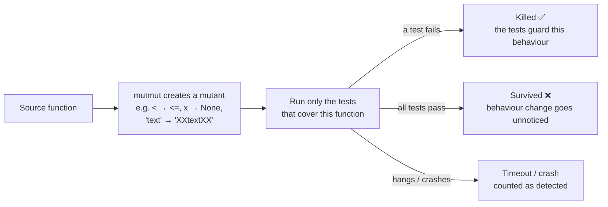
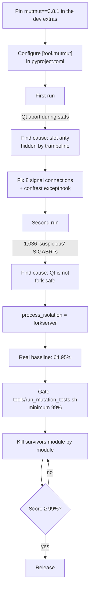
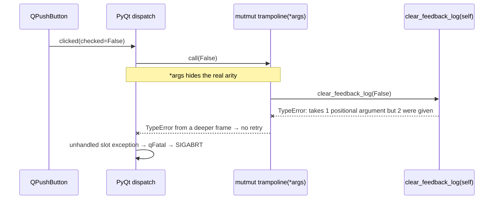
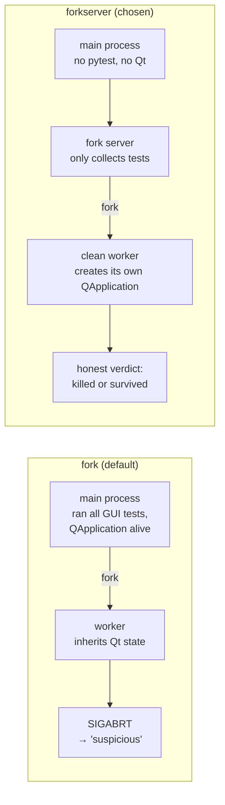
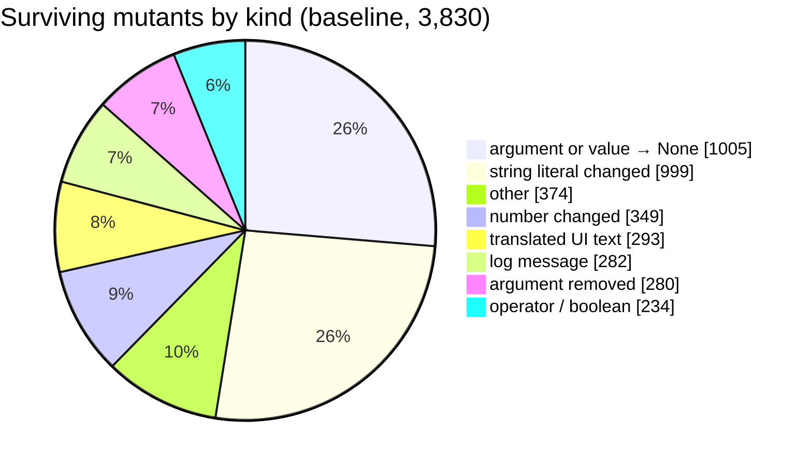
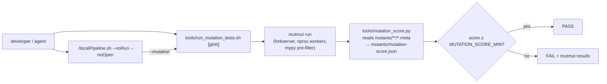
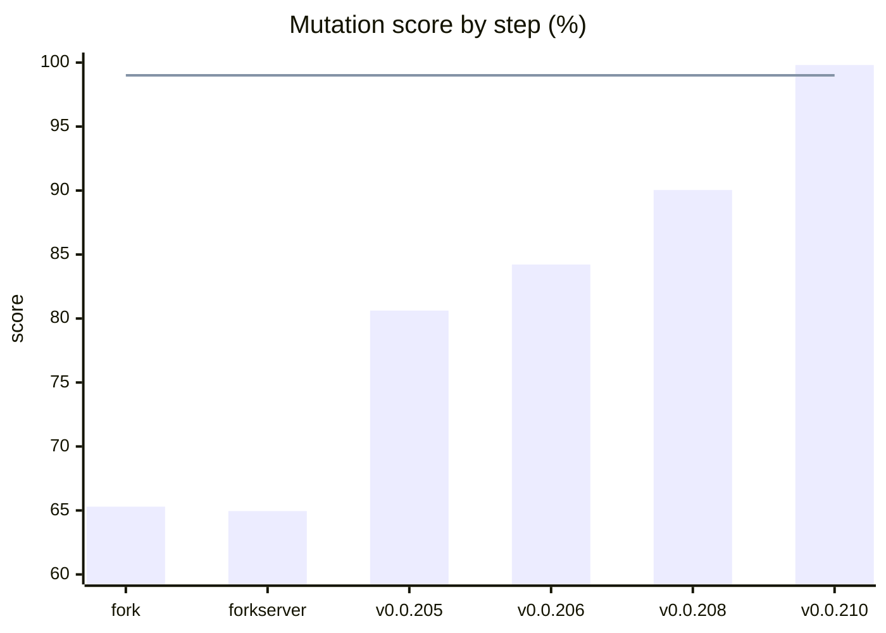

# Follow-up: Mutation Testing

How mutation testing was introduced to `myLastFmPlayer`: the process, the problems
found on the way, the results, and the target going forward. The original plan is in
[`../documents/16_MUTATION_TESTING.md`](../documents/16_MUTATION_TESTING.md).

## Starting Point

| Metric | Value at v0.0.200 (before this work) |
| --- | --- |
| Tests | 613 passed, 6 skipped (opt-in network tests) |
| Line + branch coverage | **99.01%** (gate: `--cov-fail-under=99`, two decimals) |
| Mutation testing | none |

Coverage says a line *ran* during the tests. It does not say a test would *notice*
if that line were wrong. Mutation testing measures exactly that: it plants a small
fault (a *mutant*) in the source, runs the tests that cover it, and expects at
least one to fail.

## Tool Choice

| Tool | Status (2026-11) | Decision |
| --- | --- | --- |
| **mutmut 3.8.1** | Active; pytest-native; `pyproject.toml` config; per-function test selection; incremental cache; parallel workers | **Chosen** |
| cosmic-ray 8.9.0 | Active; session database; distributed execution | Heavier than this project needs |
| poodle 1.4.0 | Small project | Fewer operators, smaller community |
| mutatest 3.1.0 | Unmaintained | Rejected |

## Process

## Findings

### 1. Qt slots break behind mutmut's trampoline

mutmut rewrites every function `f` into a `trampoline(*args, **kwargs)` that
dispatches to the original or to the active mutant. PyQt, when a signal emits more
arguments than a slot accepts (`clicked(bool)` → `def slot(self)`), first calls the
slot with all arguments and on a `TypeError` raised *by that call* retries with
fewer. Behind the trampoline the `TypeError` is raised one frame deeper, so PyQt
does not retry: the exception escapes the slot and, with no custom
`sys.excepthook`, Qt aborts the process.

**Fix:** the eight affected connections go through
`lambda _checked=False: self.slot()`, so the slot's arity is explicit and no longer
depends on PyQt's retry heuristic. `@pyqtSlot()` would also work, but mutmut does
not mutate decorated functions, so those slots would silently drop out of mutation
testing. A static scan of every `.connect(self.method)` against its signal's
argument count confirmed that no other connection is affected.

**Safety net:** `tests/conftest.py` installs a per-test `sys.excepthook`. An
exception inside a Qt slot now fails *that test* with a readable message instead of
killing the whole pytest run.

### 2. Qt is not fork-safe

mutmut's default `process_isolation = "fork"` forks each worker from the main
process, which has already run the full GUI test suite with a live `QApplication`.
About a thousand mutants died with SIGABRT in forked children and were reported as
*suspicious*. Most were really survivors: re-running `ui/flags.py` alone turned 94
aborts into 94 survivors.

**Fix:** `process_isolation = "forkserver"` in `[tool.mutmut]`. Suspicious mutants
dropped from 1,036 to 32.

### 3. High coverage, weak assertions

With an honest runner the baseline is **64.95%**: one mutant in three survives a
suite with 99% coverage. The survivors fall into a few groups:

Typical real gaps the tests did not catch:

| Mutant | What it reveals |
| --- | --- |
| `if self._is_current_worker_context(...) or True` | stale-worker results are never tested as being dropped |
| `completed_count += 1` → `completed_count = 1` | progress counts only checked for a single item |
| `set_scrobbling_enabled(enabled)` → `(None)` | the dialog's effect on settings is not asserted |
| `value(KEY, True, bool)` → `value(KEY, bool)` | a settings default is never read from an empty store |
| `volume_layout.addWidget(self.mute_checkbox)` → `(None)` | widget placement is not checked |

Cosmetic or equivalent groups: log message text, the Qt translation *context*
string (identical output while no translator is installed), and pixel coordinates
in the hand-drawn icons and flags.

Per-module baseline:

| Module | Mutants | Undetected | Score |
| --- | ---: | ---: | ---: |
| `controller.py` | 3,019 | 1,399 | 53.7% |
| `ui/main_window.py` | 2,241 | 745 | 66.8% |
| `lastfm.py` | 1,019 | 364 | 64.3% |
| `ui/preferences_dialog.py` | 544 | 232 | 57.4% |
| `download.py` | 507 | 174 | 65.7% |
| `scrobbling.py` | 300 | 142 | 52.7% |
| `youtube.py` | 470 | 112 | 76.2% |
| `ui/icons.py` | 337 | 106 | 68.5% |
| `ui/track_table_model.py` | 350 | 97 | 72.3% |
| `ui/flags.py` | 264 | 91 | 65.5% |
| `themes.py` | 443 | 70 | 84.2% |
| `storage.py` | 390 | 67 | 82.8% |
| `playback.py` | 170 | 54 | 68.2% |
| `settings.py` | 152 | 32 | 78.9% |
| `models.py` | 295 | 27 | 90.8% |
| remaining 9 modules | 425 | 120 | 71.8% |

## Targets

| Gate | Threshold | Enforced by |
| --- | --- | --- |
| Line + branch coverage | **≥ 99%** | `--cov-fail-under=99` on every `./localPipeline.sh` run |
| Mutation score | **≥ 99%** | `tools/run_mutation_tests.sh` (`MUTATION_SCORE_MIN`, default 99); opt-in pipeline stage `--mutation` |

Mutation score = (killed + caught by mypy + timeout + crashed) / all mutants.
Survivors, suspicious and untested mutants count against it.

## Tooling

- `tools/run_mutation_tests.sh`: full run; `"my_lastfm_player.storage*"` re-checks
  one module; `--report-only` re-prints the last summary.
- `.venv/bin/mutmut results` lists survivors; `.venv/bin/mutmut show <name>` shows
  one mutant's diff.
- `./localPipeline.sh --noOpen`: never opens the HTML reports (for automated runs).

## Results

| Step | Mutants | Detected | Survived | Suspicious | Score |
| --- | ---: | ---: | ---: | ---: | ---: |
| Baseline, `fork` (misleading) | 10,926 | 7,137 | 2,753 | 1,036 | 65.3% |
| Baseline, `forkserver` | 10,926 | 7,096 | 3,798 | 32 | 64.95% |
| Catalog check, golden images, log exclusion (v0.0.205) | 10,274 | 8,283 | 1,969 | 22 | 80.62% |
| Contract tests for scrobbling, playback, download, YouTube, Last.fm (v0.0.206) | 10,274 | 8,653 | 1,599 | 22 | 84.22% |
| mypy as pre-filter, controller wiring tests (v0.0.208) | 10,281 | 9,257 | 1,016 | 8 | 90.04% |
| Per-module mutation tests, equivalents marked (v0.0.210) | 9,633 | 9,615 | 6 | 12 | **99.81%** |

The log exclusion removed 652 mutants of log-message text, so the total drops from
10,926 to 10,274. Line + branch coverage rose from 99.01% to 99.28% along the way.

### What moved the score

- **Translation-catalog check** (`tests/conftest.py`): a test-only `QTranslator`
  records every runtime `tr()`/`translate()` lookup and fails the test when the
  context or string is missing from the catalog. It kills every mutated UI string on
  an executed path, and it guards against strings that would never be translated.
- **Golden images** for the hand-drawn icons and flags (±3 per channel), and a JSON
  snapshot of every theme palette colour.
- **Contract tests** that assert exact arguments, messages and state transitions:
  subprocess options, ffprobe command line, retry and backoff, auth-generation
  races, progress messages, and controller signal wiring.

### Reaching the target

The last 899 survivors were split by module across four parallel review passes.
Each pass wrote tests in its own `tests/test_<module>_mutation.py` file and proved
every kill by running that file against the single mutant
(`MUTANT_UNDER_TEST=<name>` inside `mutants/`): the test must fail for the mutant
and pass for the original. Result: 744 mutants killed by new tests, 155 marked as
provably equivalent.

Equivalent mutants carry `# pragma: no mutate` with a stated reason (116 lines in
`my_lastfm_player/`). Typical reasons: a default that the next step replaces anyway
(`int(None)` falls back to the same value), case-insensitive names (`QColor`
hex colours, `"UTF-8"`), arguments that equal the default, return values nobody
reads, and Windows-only branches on the Linux test run.

**Caveat.** mutmut excludes every mutation on a pragma'd line, including ones the
tests already killed, so those lines leave the denominator: the total falls from
10,281 to 9,633. Where a pragma would also hide a non-equivalent mutant, a separate
guard test keeps the behaviour pinned — `tests/test_encoding_contract.py` checks that
every file and subprocess pipe uses an explicit UTF-8 encoding, because
`encoding=None` would corrupt artist names on a non-UTF-8 locale.

The remaining 6 survivors and 12 suspicious mutants (0.19%) stay within the 1%
budget of the 99% target. A crash of the test process (72 mutants) counts as
detected: those mutants make Qt abort, which no user would miss either.
