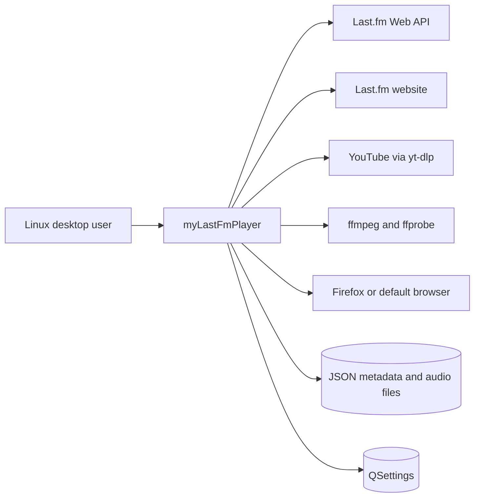
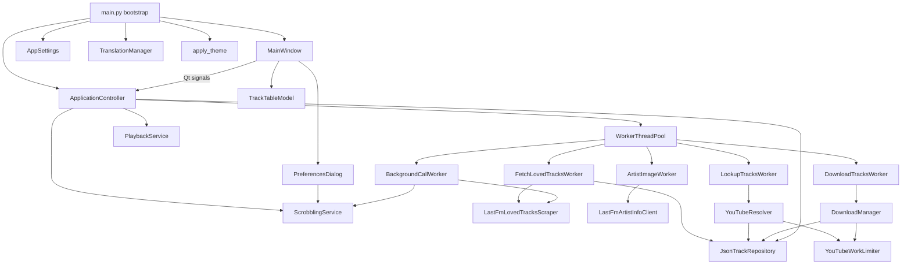
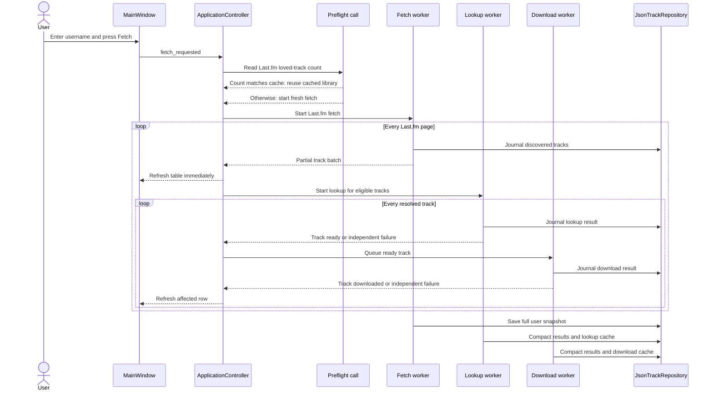
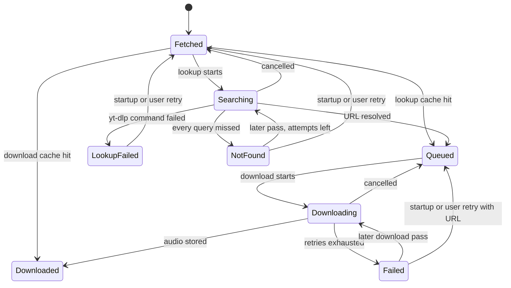

# Runtime Architecture

This document is the concise, implementation-facing architecture description for
`myLastFmPlayer`. The rendered C4 diagrams are in
[`docs/architecture.rst`](../docs/architecture.rst); the generated class reference is in
[`docs/api.rst`](../docs/api.rst).

## System Purpose

`myLastFmPlayer` is a single-process Linux desktop application. A user enters a
Last.fm username; the application discovers that account's public loved tracks,
resolves playable YouTube sources, downloads audio, and plays the resulting
local library. Authenticated now-playing updates, scrobbles, and unloving a track
on Last.fm are optional.

The application is designed around four properties:

- the Qt event loop remains responsive while network and subprocess work runs;
- each track progresses independently, so one failure does not stop the queue;
- completed work is persisted incrementally and survives cancellation or restart;
- work for one username cannot overwrite the visible state of another username.

## System Context

External responsibilities are:

| Dependency | Responsibility |
| --- | --- |
| Last.fm Web API (`requests`) | `user.getLovedTracks` pages and `artist.getInfo` metadata |
| Last.fm API (`pylast`) | Desktop authentication, now-playing, scrobbles, and unlove |
| Last.fm website | Authorization page, artist pages, and artist-page preview images |
| `yt-dlp` | YouTube search and audio extraction |
| `ffmpeg` / `ffprobe` | Audio post-processing and file-type/bitrate probing |
| Qt Multimedia | Local playback through `QMediaPlayer` |
| Desktop browser | Artist pages (Firefox private window, else the default browser) |

At startup `dependencies.py` checks that `yt-dlp`, `ffmpeg`, and `ffprobe` are on
`PATH` and reports missing tools in the UI. Loved-track discovery needs no user
authentication; authenticated features use the bundled desktop application
credentials (overridable through `LASTFM_API_KEY` and `LASTFM_API_SECRET`) plus a
user-authorized session.

## Application Components

| Module | Role |
| --- | --- |
| `main.py`, `__main__.py` | Configure logging, create `QApplication`, apply saved theme and language, restore username and geometry, wire `MainWindow` to `ApplicationController` |
| `controller.py` | `ApplicationController`: the single cross-layer coordinator; scopes worker results by username and generation and turns service outcomes into UI state |
| `worker_threads.py` | `WorkerThreadPool`: moves each worker to an owned `QThread`, retires it on `finished`, and joins every thread within a bounded time on quit |
| `workers.py` | Thread-boundary `QObject`s: fetch, lookup, download, artist image, and the generic `BackgroundCallWorker` for one blocking call |
| `lastfm.py` | `LastFmLovedTracksApiClient`, `LastFmLovedTracksScraper` (pagination, retry, pause/stop), `LastFmArtistInfoClient` (metadata and preview image) |
| `youtube.py` | `YouTubeResolver`: lookup cache, query ladder, concurrent cancellable `yt-dlp` searches |
| `download.py` | `DownloadManager`: concurrent downloads with a player-client retry ladder, jittered backoff, and `ffprobe` metadata |
| `youtube_work.py` | `YouTubeWorkLimiter` and `run_cancellable_command`: one shared process limit, per-key serialization, process-group termination |
| `playback.py` | `PlaybackService` over a `PlaybackBackend` protocol; `QtPlaybackBackend` wraps `QMediaPlayer` |
| `scrobbling.py` | `ScrobblingService`: `pylast` desktop authentication, now-playing, scrobble, love/unlove |
| `storage.py` | `JsonTrackRepository`: per-user snapshots, update journal, shared caches, credentials |
| `models.py` | Immutable `Track`, `TrackStatus`, cache keys, and the merge rules |
| `settings.py` | `AppSettings`: typed `QSettings` accessors and defaults |
| `app_credentials.py` | Bundled Last.fm application credentials with environment overrides |
| `i18n.py`, `themes.py` | Live language switching through `QTranslator`; Fusion-style Light, Dark, Lilac, and Mint palettes |
| `ui/main_window.py` | `MainWindow`, filter proxy, eliding labels, artwork label, menus, shortcuts, context menu |
| `ui/track_table_model.py`, `ui/preferences_dialog.py` | Table model with tooltips and translated status; scrollable Preferences dialog |
| `ui/icons.py`, `ui/flags.py` | Icons and language flags painted in code |
| `qt_signal.py` | Typing shim: re-exports `pyqtSignal` unchanged at runtime and gives mypy a correct signature |
| `version.py`, `logging_config.py` | Single version source with optional build commit suffix; stdout logging at INFO |

Services own no widgets. `MainWindow` emits semantic signals and never calls a
service; the controller performs the work and pushes the resulting state back.

## End-to-End Workflow

The phases overlap deliberately. Later Last.fm pages can still be arriving while
earlier entries are being checked and downloaded. Lookup completion can feed download
immediately; it does not wait for the whole lookup batch.

### Last.fm Discovery

`LastFmLovedTracksApiClient` requests `user.getLovedTracks` JSON pages. The scraper
follows the API's `page` and `totalPages` metadata, retries transient errors with a
fixed delay and a bounded attempt count, waits briefly between pages, and emits
progress plus partial track lists. Fetch has independent Pause/Resume and Stop
controls.

Before a fetch, a `BackgroundCallWorker` reads the account's loved-track count. When
the cached library has exactly that many entries, the controller reuses it and skips
the paginated fetch; otherwise, or when the count is unavailable, it starts the fetch
worker. When Last.fm cannot be reached but a cached library exists, the cache is used.

Each discovered `Track` begins with artist, title, optional Last.fm URL and loved-at
timestamp, and `Fetched` status. Applying the lookup and download caches can
immediately advance a track to `Queued` or `Downloaded`.

### YouTube Lookup and Download

Lookup and download use one shared concurrency setting:

- valid range: one through five;
- default: five;
- the limit counts lookup and download subprocesses together;
- changing it affects work that has not acquired a slot yet;
- a per-target key prevents two tracks whose names sanitize to one audio file from
  downloading at once, while a per-track key serializes repeated searches for one track;
  the two key spaces are namespaced so they cannot collide inside the shared limiter.

Lookup checks the shared cache before invoking `yt-dlp`. On a miss it tries a query
ladder: exact artist/title, the artist without store suffixes and decorative symbols
plus title, and title alone. A hit becomes `Queued`. A ladder in which every query
returned no result becomes `Not found` and counts one lookup attempt; a failing
`yt-dlp` command becomes `Lookup failed`. A `Not found` track is searched again in
later lookup passes until it has used its bounded number of lookup attempts.

Each track counts its lookup and download attempts separately (`lookup_attempts` and
`download_attempts`). Only the lookup budget gates re-checking a `Not found` track, so a
run of failed downloads cannot consume the allowance that decides whether the track is
searched again. Libraries written before the split are read back with their old
`retry_count` as the download budget.

Download asks `yt-dlp` for the best available audio stream. Failed attempts are retried
after a random backoff, and each retry forces a different YouTube player-client family,
because a client YouTube currently gates offers no audio at all. `ffprobe` records the
resulting file type and bitrate. A successful file becomes `Downloaded`; exhausted
retries become `Failed`. A `Failed` track with a URL is retried by later download passes.

### Stop, Resume, and Username Switching

The visible **Stop YouTube** control covers both lookup and download. It sets the
operation-owned cancellation events, wakes threads waiting for capacity, and
terminates active external process groups. Cancelled lookups return to `Fetched` and
cancelled downloads to `Queued`. The UI stays in `Stopping…` until every owned worker
has finished cleanup. If eligible entries remain, the action then becomes
**Resume YouTube** and restarts only unresolved or queued work.

The username field stays editable throughout discovery, lookup, and download. Editing
it advances the controller's workflow generation and cancels work for the previous
username. Completed journal entries stay saved, while late Qt signals are rejected
unless their username and generation still match the current workflow. This makes
entries and user libraries independent even when cancellation completes asynchronously.

The feedback panel retains separate Last.fm discovery, YouTube-check, and download
progress values. `_run_worker` derives a stable presentation stage from the concrete
worker type and captures it with the worker's username and generation, so concurrent
signals cannot overwrite another stage and a failure marks only its originating stage.
The stage presentation resets atomically when username editing retires an identity,
when a programmatic identity switch is committed, and before a fresh fetch starts.

Quitting cancels every workflow worker and pending service call, then
`WorkerThreadPool.shutdown()` joins each thread within a bounded wait before Qt
destroys the window, so no running `QThread` or `yt-dlp` process group outlives it.

### Playback, Retry, and Unlove

Selecting an unavailable track and pressing Play starts a one-track priority lookup or
download without losing the background queue. When the local file becomes ready, the
controller starts playback. Normal controls provide pause/resume, stop, seek, volume,
mute, next-track, and randomized continuation. Scrobbling is submitted on a background
call once a third of the track has been played since the last seek.

The now-playing field is a horizontally ignored, single-line `ElidedLabel`: it retains
the complete artist/title value for its tooltip while its visible form follows the
available playback width. Preferences uses a resizable scroll viewport for setting
groups, bounds the dialog to 90% of the active screen, and leaves Close in the fixed
outer layout so it remains reachable when content overflows.

Artist artwork loads on an `ArtistImageWorker`. The preview stays at a bounded size and
is hidden when no valid image is available, so it cannot consume vertical space from
the track table or stretch the playback controls. Activating it opens the artist page
in a Firefox private window, falling back to the default browser when Firefox cannot
be started.

The library filter matches artist, title, translated status, and stored error details.
Selection drives a visible retry action: lookup failures and `Not found` results
restart a priority YouTube check, while download failures with a retained URL restart
only the download. Completed rows expose no retry action, and the controller validates
the durable state again before resetting it.

The track context menu offers **Unlove on Last.fm…**. `MainWindow` asks the controller
whether the action is available: only with a connected Last.fm session, for the
connected account's own list, with no fetch, lookup, or download worker running for
that list, and with no other unlove in flight. After an explicit confirmation the
controller sends the unlove through a `BackgroundCallWorker`; on success it removes the
row from the stored library, and on failure it keeps the row and reports the error.

Keyboard commands are owned by `MainWindow`. F5 starts a fetch, Ctrl+F focuses the
library filter, Ctrl+, opens Preferences, and Ctrl+Q quits. The Space playback shortcut
is disabled while native text, button, slider, feedback, or artist-image input has
focus, preserving normal widget behavior. The artist image has its own
Enter/Return/Space handling when a page URL exists. Qt label buddies and explicit
accessible names connect labels, sliders, the table, progress bars, artwork, and
feedback.

## Threading Model

```mermaid
flowchart LR
    UI[UI thread: widgets, controller, repository callbacks] -->|start| Pool[WorkerThreadPool]
    Pool -->|moveToThread + run| W[Worker QObject on owned QThread]
    W -->|queued signals| UI
    W --> Exec[ThreadPoolExecutor inside lookup/download]
    Exec --> Limiter[YouTubeWorkLimiter slot]
    Limiter --> Proc[yt-dlp / ffprobe process group]
    Prefs[PreferencesDialog] -->|daemon thread| Auth[BackgroundCallWorker for auth calls]
    Auth -->|queued signals| UI
```

- Workflow workers (fetch, lookup, download), artwork workers, and the controller's
  service calls all run on `QThread`s owned by `WorkerThreadPool`. Results reach the
  UI thread through queued Qt signals.
- `BackgroundCallWorker` runs one blocking callable (loved-track count preflight,
  stored-session verification, now-playing, scrobble, unlove) and suppresses delivery
  after `cancel()`.
- `PreferencesDialog` runs its authentication calls through `BackgroundCallWorker` on
  short-lived daemon threads; authentication generations stop a late verification
  from reconnecting a session the user just disconnected.
- Lookup and download fan out over a `ThreadPoolExecutor`; every subprocess first
  acquires a `YouTubeWorkLimiter` slot.
- Every worker `run()` catches exceptions at the thread boundary, emits `error`, and
  emits `finished` from `finally`.

## Track State Model

On startup the controller re-checks what the previous run gave up on: it clears
`Not found` entries from the lookup cache and resets them to `Fetched`, resets
`Failed` and `Lookup failed` entries to `Queued` (URL known) or `Fetched`, and starts
the normal lookup or download queue.

Playback is runtime state owned by `PlaybackService`; it does not replace the durable
`Downloaded` track status. The `Track` value object is immutable.
`Track.merge_preserving` never moves a status backwards, keeps known fields when a newer
snapshot lacks them, and makes one exception: a track may leave `Not found` once a
lookup finally produces a URL.

## Persistence

Mutable application data lives below `$XDG_DATA_HOME/myLastFmPlayer/`, defaulting to
`~/.local/share/myLastFmPlayer/`:

| Path | Format | Purpose |
| --- | --- | --- |
| `tracks/<username>.json` | JSON array of tracks | Compact per-user track snapshot |
| `tracks/<username>.updates.jsonl` | JSON Lines | Append-only updates written during active work |
| `lookup-cache.json` | JSON array of tracks | Shared resolved URLs and bounded `Not found` state |
| `download-cache.json` | JSON array of tracks | Shared artist/title-to-local-file mappings |
| `lastfm-credentials.json` | JSON object | Authorized Last.fm username, session key, scrobbling choice |
| `downloads/` | Audio files | Downloaded audio named `<Artist> - <Title>` |

The username part of a path is sanitized. Caches are keyed by `Track.cache_key`, the
exact artist and title joined by a unit separator, which is the project-wide track
identity across UI rows, persistence, and caches.

Repository access is protected by a re-entrant lock. Snapshot, cache, and credential
writes use a same-directory temporary file followed by atomic replacement. Each journal
append is flushed and `fsync`ed, which makes a completed entry durable without
rewriting a large library after every result. Loading replays the journal over the
snapshot; saving a snapshot removes the journal.

Theme, language, volume, mute, randomized continuation, last Last.fm username,
scrobbling choice, `yt-dlp` cookie browser, window geometry, data retention, and
YouTube concurrency live in `QSettings`. Metadata and credentials are retained on quit
by default. Users can opt into cleanup on quit, which removes track lists, journals,
caches, and credentials; downloaded audio is never removed by that preference.

## Failure Boundaries

- A lookup or download failure updates only that track and does not stop peer work.
- External commands have timeouts and cooperative process-group cancellation.
- Worker callbacks are scoped to their username and workflow generation.
- Repository updates are locked, atomic, and recoverable from the update journal.
- Network-dependent integration tests are opt-in; deterministic unit, UI, packaging,
  documentation, lint, type, translation, and coverage checks run in the normal pipeline.

## Quality Tooling

`localPipeline.sh` is the canonical gate, used locally and replicated in CI:

```mermaid
flowchart LR
    Venv[.venv + editable dev install] --> Ruff[Ruff]
    Ruff --> Pylint[Pylint 10.00/10]
    Pylint --> Mypy[mypy, zero errors]
    Mypy --> Tr[Translation completeness]
    Tr --> Docs[tools/check_docs.py]
    Docs --> Sphinx[Sphinx, warnings as errors]
    Sphinx --> Pytest[pytest + 99% line and branch coverage]
    Pytest --> Build[sdist + wheel build]
    Build --> Install[wheel install + import check]
    Install --> Mut[Mutation gate, opt-in with --mutation]
    Mut --> Launch[Launch app unless --noRun]
```

- `--noRun` skips the GUI launch and `--noOpen` keeps the Sphinx and coverage HTML
  reports from opening in a browser; CI and automated runs pass both. `--report-dir`
  keeps stage logs, JUnit XML, coverage XML, and environment metadata.
- mypy checks `my_lastfm_player/` with the `[tool.mypy]` settings in `pyproject.toml`;
  the `union-attr` and `override` codes are disabled because the PyQt6 stubs mark
  nearly every Qt getter and event parameter as optional.
- `tools/run_mutation_tests.sh` runs mutmut over `my_lastfm_player/` and fails below
  `MUTATION_SCORE_MIN` percent (default 99). `[tool.mutmut]` in `pyproject.toml` uses
  `forkserver` isolation because Qt is not fork-safe, skips log calls, and runs mypy as
  a type-check pre-filter. Killed, mypy-rejected, timed-out, and crashing mutants count
  as detected. `tools/mutation_score.py` reads the results under `mutants/`, prints the
  score, and writes `mutants/mutation-score.json`. A glob such as
  `"my_lastfm_player.storage*"` re-checks one module. The gate is opt-in because a full
  run takes minutes.
- `tests/conftest.py` installs a catalog-checking `QTranslator` for the whole session:
  every runtime `tr()`/`translate()` lookup must exist in the German `.ts` catalog,
  otherwise the triggering test fails. A per-test `sys.excepthook` turns an exception
  raised inside a Qt slot into a test failure instead of a process abort.
- `tests/fixtures/golden/` holds reviewed PNGs of the painted icons and flags
  (compared with a small per-channel tolerance) and `theme_palettes.json`, a snapshot of
  every theme colour. `MY_LASTFM_PLAYER_UPDATE_GOLDEN=1` regenerates them.
- Slots of signals that carry arguments are connected through
  `lambda _checked=False: self.slot()`, so they keep working behind mutmut's `*args`
  trampolines.
- Signals are declared with `pyqtSignal` from `my_lastfm_player.qt_signal`, which is
  PyQt's own object at runtime; for mypy it supplies the default the stubs omit for the
  keyword-only `arguments` parameter.

## Deployment and Release

`my-lastfm-player` and `python -m my_lastfm_player` enter the same startup path. The
package supports Python 3.14 or newer on Linux x86_64. `version.py` is the single
version source; built packages add a six-character commit suffix to the displayed
version. A release is built only after the canonical `localPipeline.sh` gate passes.
The manual GitHub workflow rebuilds and verifies the project, then publishes the wheel,
source distribution, documentation, C4 diagrams, tests, coverage, static-analysis
results, and pipeline provenance.
