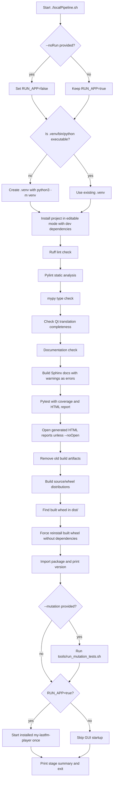

# Agent Guidelines

Rules and repository notes for every automated coding assistant working on this
project. [`../docs/agents.md`](../docs/agents.md) is the authoritative contribution
policy; this file provides the expanded command and architecture reference.

## Common Commands

All commands assume the project's `.venv` is active or that binaries are invoked
through `.venv/bin/`.

- Full local pipeline: `./localPipeline.sh`
- Pre-commit pipeline without launching the GUI: `./localPipeline.sh --noRun`
- Automated (agent) pipeline run, no GUI and no browser tabs:
  `./localPipeline.sh --noRun --noOpen`
- Run the app from source: `my-lastfm-player` or `python -m my_lastfm_player`
- Lint: `python -m ruff check .`
- Static analysis: `python -m pylint my_lastfm_player`
- Type check: `python -m mypy` (configuration in `[tool.mypy]` of `pyproject.toml`)
- Tests with coverage: `python -m pytest`
- Single test: `python -m pytest tests/test_controller.py::test_name -v`
- Live Last.fm end-to-end test:
  `MY_LASTFM_PLAYER_RUN_LASTFM_E2E=1 python -m pytest tests/test_lastfm_e2e.py`
- Live Last.fm love/unlove test (writes to the connected account):
  `MY_LASTFM_PLAYER_RUN_LASTFM_WRITE_E2E=1 python -m pytest tests/test_lastfm_love_e2e.py`
- Mutation-testing gate (minutes; opt-in pipeline stage):
  `tools/run_mutation_tests.sh` or `./localPipeline.sh --noRun --noOpen --mutation`
- Documentation gate: `python tools/check_docs.py`
- Sphinx docs:
  `python -m sphinx -W --keep-going -b html docs docs/_build/html`
- Regenerate Qt translation source files after changing user-visible strings:
  `tools/update_translations.sh`
- Compile Qt translation files after regeneration:
  `tools/compile_translations.sh`

`./localPipeline.sh --noRun` is the canonical check before every commit. Automated
assistants must add `--noOpen` so the run does not open HTML reports in the
maintainer's browser.

## Commit Messages

Use Conventional Commits format for every commit subject:

```text
<type>(<scope>): <short summary>
```

Common types: `feat`, `fix`, `docs`, `refactor`, `test`, `chore`.

Include a body that explains why the change was made, what problem it solves,
and any non-obvious decisions. Reference the improvement or bug number when
applicable.

## Versioning

`my_lastfm_player/version.py` is the single source of truth for `__version__`.
`pyproject.toml` reads it through `attr =`.

Bump `my_lastfm_player/version.py` with every commit:

- `PATCH` for bug fixes and small improvements
- `MINOR` for new features
- `MAJOR` for breaking changes

Update `README.md` (``Current version: `x.y.z` `` and the release-wheel file name)
and the exact package/display version assertions in `tests/test_app_smoke.py` in the
same commit.

`setup.py` writes a generated `my_lastfm_player/_build_info.py` into built packages,
so they display `x.y.z+<six-character commit>`. Source-tree runs intentionally show
only the base version when that generated file is absent.

## Pipeline

Run `./localPipeline.sh --noRun` before every commit and ensure all mandatory
stages pass. A red pipeline means no commit.

Stages that must be green: Ruff lint, Pylint, mypy, docs check, Sphinx, tests and
coverage, package build, wheel install, and the import check. Translation
completeness is reported as `WARN` rather than `FAIL` by the script, but untranslated
strings are still not allowed in a commit. The configured coverage gate in
`pyproject.toml` is the source of truth for the required minimum.

`localPipeline.sh` is the canonical build workflow. It records each stage as
`PASS`, `FAIL`, `SKIP`, or `WARN` and prints the complete summary at the end.



The workflow phases are:

1. Argument handling accepts `--noRun`, `--noOpen`, `--mutation`, and
   `--report-dir PATH`.
2. Environment preparation creates `.venv` when needed and otherwise reuses it.
3. Dependency installation runs `python -m pip install -e ".[dev]"`.
4. Quality gates run Ruff, Pylint, mypy, translation and documentation checks,
   Sphinx with warnings as errors, and pytest with the configured coverage threshold.
5. Report opening prints the Sphinx and coverage HTML paths and attempts to open
   them unless `--noOpen` was supplied; an unavailable browser is a warning
   rather than a build failure.
6. Package build removes stale output before building source and wheel
   distributions.
7. Install verification installs the new wheel and imports `my_lastfm_player`.
8. With `--mutation`, and only when the tests passed, the mutation-testing gate runs;
   a failing gate fails the pipeline.
9. Runtime launch starts `my-lastfm-player` unless `--noRun` was supplied; a failed
   launch is a warning only.
10. The final summary reports every stage as `PASS`, `FAIL`, `SKIP`, or `WARN`.

To preserve the machine-readable test and coverage results, stage logs,
environment metadata, and final summary for release artifacts:

```sh
./localPipeline.sh --noRun --noOpen --report-dir release-artifacts/raw
```

After a run, the HTML reports are at `htmlcov/index.html` and
`docs/_build/html/index.html`.

### Mutation Testing

Quality targets: line+branch coverage **at least 99%** (enforced by
`--cov-fail-under=99` on every pipeline run) and a mutation score **at least 99%**
(enforced by `tools/run_mutation_tests.sh`, threshold `MUTATION_SCORE_MIN`).

`tools/run_mutation_tests.sh` runs mutmut over `my_lastfm_player/` and fails when
the mutation score is below the threshold. mutmut runs mypy as its
`type_check_command`, so a mutant mypy rejects counts as detected, like killed,
timed-out, and crashing mutants. `tools/mutation_score.py` computes the score from
`mutants/**/*.meta`, prints it, and writes `mutants/mutation-score.json`. The gate is
opt-in in the pipeline (`--mutation`) because a full run takes minutes; run it when
tests or tested logic change, and before every release. Pass a mutant glob such as
`"my_lastfm_player.storage*"` to re-check one module, and `--report-only` to
re-print the last summary. `.venv/bin/mutmut results` lists survivors. Plan and
results are in [`16_MUTATION_TESTING.md`](16_MUTATION_TESTING.md).

Two suite-wide checks back the mutation score:

- `tests/conftest.py` installs a catalog-checking `QTranslator`: every runtime
  `tr()`/`translate()` lookup must exist in `my_lastfm_player_de.ts`, otherwise the
  test that triggered it fails. After adding a UI string, run
  `tools/update_translations.sh` as usual.
- `tests/test_golden_images.py` and the palette snapshot in `tests/test_themes.py`
  pin the hand-drawn icons, flags and theme colours. After an intentional visual
  change, regenerate with `MY_LASTFM_PLAYER_UPDATE_GOLDEN=1 python -m pytest
  tests/test_golden_images.py tests/test_themes.py` and review the files in
  `tests/fixtures/golden/`.

Connect Qt signals that carry arguments (`clicked`, `triggered`, …) to slots that
take none through `lambda _checked=False: self.slot()`. mutmut wraps every method
in a `*args` trampoline, so PyQt can no longer drop the extra argument itself.

### Opt-in Network Tests

The normal pipeline needs no internet access. The live checks are opt-in so the
gate stays deterministic:

```sh
MY_LASTFM_PLAYER_RUN_LASTFM_E2E=1 ./localPipeline.sh --noRun
MY_LASTFM_PLAYER_RUN_YTDLP_E2E=1 ./localPipeline.sh --noRun
```

The Last.fm test fetches every loved-track API page for the test user `first`.

`MY_LASTFM_PLAYER_RUN_LASTFM_WRITE_E2E=1` enables the only test that writes to
Last.fm. It uses the session the app stored after "Connect to Last.fm", loves the
sentinel track "Kevin MacLeod – Monkeys Spinning Monkeys" and unloves it again — once
through `ScrobblingService` directly and once through the track context menu and the
controller. It skips instead of touching the sentinel when it is already loved, and
always unloves it again in a `finally` block.

The `yt-dlp` tests check the download retry ladder against the installed
`yt-dlp`: every forced YouTube player client must still be one `yt-dlp`
supports, the audio format selector must still resolve, and a real download must
complete. A client name `yt-dlp` no longer knows is only reported as a
skipped-client warning, so without this check that rung would quietly waste a
retry.

## Architecture Notes

This is a PyQt6 desktop app that fetches a user's Last.fm loved tracks, resolves
them to YouTube via `yt-dlp`, downloads audio, and plays it locally. The codebase
uses a controller-mediated worker pipeline whose fetch, lookup, and download phases
can overlap while each track remains independent.

- `main.py`: wires `QApplication`, `AppSettings`, `TranslationManager`, the theme,
  `MainWindow`, and `ApplicationController`, and restores the saved session.
- `controller.py`: central orchestrator. Connects `MainWindow` signals, starts
  workers, scopes their results by username and generation, and chains fetch,
  lookup, download, playback, scrobbling, retry, and unlove workflows.
- `worker_threads.py`: `WorkerThreadPool` moves each worker to an owned `QThread`,
  retires it on `finished`, and joins all threads within a bounded time on quit.
- `workers.py`: `FetchLovedTracksWorker`, `LookupTracksWorker`,
  `DownloadTracksWorker`, `ArtistImageWorker`, and `BackgroundCallWorker` (one
  blocking service call). Worker `run()` methods catch exceptions at the thread
  boundary, emit `error` (or `failed`), and always emit `finished`.
- `lastfm.py`: `LastFmLovedTracksScraper` orchestrates Last.fm Web API
  pagination. `LastFmLovedTracksApiClient` fetches `user.getLovedTracks` JSON,
  and `LastFmArtistInfoClient` fetches artist preview metadata and images.
- `youtube.py`: checks the lookup cache and runs concurrent, cancellable `yt-dlp`
  searches over a bounded query ladder.
- `youtube_work.py`: applies one shared one-to-five process limit across lookup and
  download, serializes work for the same track, and terminates cancelled processes.
- `download.py`: selects the best available audio with concurrent retry/backoff,
  priority support, cancellation, and optional per-run limits; `ffprobe` records media
  type and bitrate.
- `scrobbling.py`: `ScrobblingService` wraps `pylast` for desktop authentication,
  now-playing, scrobbles, and love/unlove.
- `playback.py`: wraps `QMediaPlayer`. The Qt backend is lazy-instantiated
  through `ApplicationController.playback_service` so headless tests do not need
  multimedia objects until playback is requested.
- `storage.py`: manages per-user tracks, download cache, lookup cache, and
  Last.fm credentials. New persisted JSON should use `_atomic_write_json`.
- `models.py`: `Track.cache_key` is the project-wide identity for tracks across
  UI rows, persistence, and caches.
- `settings.py`: `AppSettings`, typed `QSettings` accessors and defaults.
- `ui/main_window.py`, `ui/track_table_model.py`, `ui/preferences_dialog.py`: UI
  shell, table model, and Preferences. The window emits semantic signals; the
  controller performs the work. `ui/icons.py` and `ui/flags.py` paint icons in code.
- `qt_signal.py`: typing-only shim. At runtime it is PyQt's own `pyqtSignal`; for
  mypy it adds the default the PyQt6 stubs omit for the `arguments` parameter.
- `dependencies.py`: checks external `yt-dlp`, `ffmpeg`, and `ffprobe` availability.
- `i18n.py`: `TranslationManager` and `translate(...)` helpers for live language
  switching; `themes.py`: Fusion-based Light, Dark, Lilac, and Mint palettes.

## Conventions

- Worker boundaries: never let exceptions escape `Worker.run()`. Emit through
  the `error` signal and emit `finished` from `finally`.
- Cache key identity: when locating a track inside lists, persisted data, or
  caches, match by `cache_key`, not by `(artist, title)` tuples or row index.
- Atomic writes: do not write user-facing JSON files in place. Use repository
  helpers that call `_atomic_write_json`.
- Translatable strings: user-visible strings in `controller.py`, `workers.py`,
  and `ui/*` should use `translate(...)` or Qt translation APIs. After changing
  them, run `tools/update_translations.sh` and `tools/compile_translations.sh`
  and include updated `.ts`/`.qm` files.
- Qt tests: use the `qapp` fixture for Qt-touching tests so the suite remains
  headless.
- Qt signals: import `pyqtSignal` from `my_lastfm_player.qt_signal`, not from
  `PyQt6.QtCore`, and add every new signal name to `exclude-members` in
  `docs/conf.py` (or to the module's `:exclude-members:` in `docs/api.rst`).
- New modules: add public modules to `docs/api.rst`.
- Historical improvement records in `documents/05_IMPROVEMENTS.md` are not the active
  backlog; use the issue tracker and current review documents for new work.

## Documentation

`tools/check_docs.py` enforces required documentation files and Markdown hygiene.
Every Markdown file must have a top-level `# ` heading, avoid trailing
whitespace, and end with a newline. `README.md` must keep its author, license,
current-version, and versioning/installation snippets, and
`documents/00_REQUIREMENTS.md` and `documents/03_ARCHITECTURE.md` must not contain
any release number, because they describe the current code.

## Quality Checklist

1. `./localPipeline.sh --noRun --noOpen` passes.
2. New modules are added to `docs/api.rst`.
3. Version is bumped in `version.py`, `README.md`, and smoke tests when required.
4. Translations are regenerated and compiled when user-visible strings changed.
5. Relevant improvement or bug entries are marked `fixed:` when applicable.
