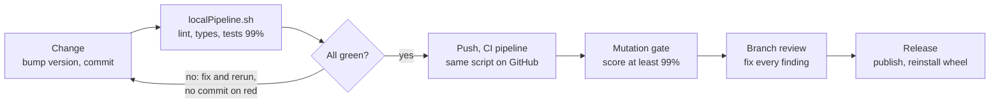

# Quality Playbook: Review, Testing, Mutation, Docs

How myLastFmPlayer keeps a Python/PyQt6 app correct: every commit passes one local
pipeline (lint, types, docs, tests at 99% coverage, packaging), the tests themselves
are checked by mutation testing at 99.81%, and reviews follow a fixed, evidence-based
format. Copy the parts below into another project in the order of the checklist at
the end. Figures are as of release 0.0.212 (2026-11-17).

## At a glance



A red pipeline sends the change back to its author; the slower mutation gate and the
branch review run before each release, not on every commit.

## Code review

Every branch gets a risk-based review of only what it adds, and every finding must be
verified in the code before it is written down. The review runs as a reusable agent
skill (`/reviewBranch`) and is repeated before every release; all findings are fixed,
not just listed.

**Scope and method**

1. Resolve the base: of `main`, `master`, `develop`, take the one whose
   `git merge-base HEAD <branch>` is most recent; review `git diff <merge-base>...HEAD`
   (three dots, so later base commits are not blamed on the branch). State base and
   merge-base at the top.
2. Two categories only: **Code** (correctness, regressions, error paths, resource
   lifetime, concurrency, hostile input, tests, CI) and **Architecture** (boundaries,
   coupling, contracts, invariants spread too wide, rollout risk).
3. Read every touched file and its call sites; trace values from entry to use and work
   the error path, not only the happy path.
4. A separate pass for removed or bypassed behaviour: for every deleted or weakened
   guard, name the invariant it enforced and find where the new code still enforces
   it. Not found = a finding.
5. Drop anything unverified or speculative. Zero findings is a valid result; never pad.

**Finding format** (written for a reader who may only read the first line)

```markdown
**[SEVERITY][Category]** What is wrong, in one sentence; what to do instead.

<details><summary>More info</summary>

- Failure scenario: input/state -> wrong result
- Evidence: file:line, snippet, command output, test result
- Fix: the concrete change, ideally plus a test that catches it

</details>
```

| Severity | Meaning |
| --- | --- |
| HIGH | Likely breakage, defeats a safety check, or a design that is expensive to undo; blocks the merge |
| MEDIUM | Real defect or weakness; fix or ticket before merge |
| LOW | Worth fixing, not blocking |
| Praise | Good work worth naming, with one optional idea for later |

Rules that keep it trusted: one comment per finding, pinned to the line; no internal
IDs; show, do not claim ("I broke X on purpose and the tests stayed green"); state a
trade-off up front; end with a verdict (not mergeable / mergeable once MEDIUM threads
are answered / good to merge) and what happens next. Nothing is posted, approved or
merged without the owner's OK.

## Testing

One pytest suite (1,056 tests, about 5 s) covers logic, UI and packaging; it is
deterministic, needs no network, and runs headless (`QT_QPA_PLATFORM=offscreen`).
Tests assert exact behaviour, not just that code ran.

| Layer | What it pins | Example file |
| --- | --- | --- |
| Unit and contract tests | Exact arguments passed to collaborators (subprocess options, HTTP params), exact error messages, retries and backoff, state transitions | `tests/test_download_contract.py` |
| Controller wiring | Every signal a worker emits reaches the right handler with the right username and payload; stale-generation emissions are dropped | `tests/test_controller_wiring.py` |
| UI behaviour | Public methods and Qt events drive the window; widget state, texts and emitted signals are asserted | `tests/test_main_window_mutation.py` |
| UI construction snapshots | A reviewed JSON of the widget tree: every scalar Qt property plus the full layout tree (spacing, margins, order, stretch) | `tests/test_ui_snapshots.py`, `tests/qt_snapshot.py` |
| Golden images | Hand-painted icons and flags as PNGs (±3 per channel), every theme palette colour as JSON | `tests/test_golden_images.py` |
| Packaging and metadata | Release artifacts, version consistency, docs presence | `tests/test_release_artifacts.py` |
| Opt-in live tests | Real Last.fm and yt-dlp, enabled by environment variables, never in the default gate | `tests/test_lastfm_e2e.py` |

**Suite-wide safety nets in `tests/conftest.py`**

- A per-test `sys.excepthook`: an exception inside a Qt slot fails that one test
  instead of aborting the whole process.
- A catalog-checking `QTranslator`: every runtime `tr()`/`translate()` lookup must
  exist in the translation catalog, so a mutated or untranslatable UI string fails the
  test that triggered it.
- The `QApplication` is created lazily by a fixture, never at import time, so forked
  mutation workers start clean.

**Conventions**

- Goldens and snapshots are regenerated only on purpose
  (`MY_LASTFM_PLAYER_UPDATE_GOLDEN=1`) and the diff is reviewed.
- Snapshots exclude anything font-, screen- or geometry-dependent; the CI runner has
  different fonts (this caught `QHeaderView.minimumSectionSize`).
- Tests that start real threads join them before the test ends and keep a reference to
  the worker; an unreferenced worker is garbage-collected and the thread never
  finishes.
- Repeat the full suite several times after adding threaded tests; one intermittent
  crash is a real bug.

## Coverage

Line and branch coverage must stay at 99% or above on every commit (currently 99.52%);
the gate lives in `pyproject.toml`, so it applies wherever pytest runs.

```toml
[tool.pytest.ini_options]
addopts = ["--strict-config", "--strict-markers", "--cov=my_lastfm_player",
           "--cov-report=term-missing", "--cov-report=html:htmlcov", "--cov-fail-under=99"]

[tool.coverage.run]
branch = true

[tool.coverage.report]
precision = 2   # 98.995% must not round up to 99%
```

Coverage only proves a line ran. Here it was 99% while only 65% of planted faults were
caught, which is why mutation testing (next section) is the second gate. Code that
cannot run on the CI platform (Windows-only branches) is marked `# pragma: no cover`
with a reason, never left uncovered silently.

## Mutation testing

The tests are themselves tested: mutmut plants small faults (mutants) and a test or the
type checker must reject each one. The gate requires a mutation score of at least 99%;
the last full run scored 99.81% (9,615 of 9,633 detected). The score rose
64.95% → 80.62% → 84.22% → 90.04% → 99.81% over five steps.

**Tool and setup**

- mutmut 3.8.1 (active, pytest-native, configured in `pyproject.toml`); cosmic-ray was
  too heavy, mutatest is unmaintained.
- Score = (killed + caught by mypy + timeout + crashed) / all mutants. Survivors,
  suspicious and untested mutants count against it.
- `tools/run_mutation_tests.sh` runs mutmut with all cores and fails below
  `MUTATION_SCORE_MIN` (default 99); `tools/mutation_score.py` computes the score from
  the per-mutant results, because mutmut's own CI stats omit type-check catches.
  Opt-in pipeline stage: `./localPipeline.sh --mutation`. A full run takes about
  15 minutes, so it runs before releases, not on every commit.

```toml
[tool.mutmut]
source_paths = ["my_lastfm_player/"]
pytest_add_cli_args = ["--no-cov", "-q"]
pytest_add_cli_args_test_selection = ["tests/"]
process_isolation = "forkserver"   # Qt is not fork-safe
type_check_command = ["mypy", "--output", "json"]
do_not_mutate_patterns = ['\bLOGGER\.(debug|info|warning|error|exception|critical)\(']
also_copy = ["README.md", "docs/", "documents/", "tools/", ".github/"]
```

**What moved the score most**

| Step | Effect |
| --- | --- |
| mypy as pre-filter (clean baseline first) | 4,613 mutants rejected before any test runs: a bool set to `None`, a required argument dropped |
| Translation-catalog check | Every mutated UI string on an executed path fails a test |
| Golden images and UI snapshots | Kill drawing, layout, spacing and widget-flag mutants in bulk |
| Contract tests per module | Exact arguments, messages and transitions instead of call counts |
| Log calls excluded | 652 mutants of log text removed; PIT does the same by default |

**Killing survivors in parallel.** Survivors are dumped per module (mutant name +
diff). Each module gets its own `tests/test_<module>_mutation.py`, so several people or
agents can work at once without conflicts. A kill is proven against the single mutant
from the prebuilt `mutants/` copy:

```sh
cd mutants
MUTANT_UNDER_TEST='<mutant name>' QT_QPA_PLATFORM=offscreen \
  ../.venv/bin/python -m pytest -q --no-cov ../tests/test_<module>_mutation.py   # must FAIL
MUTANT_UNDER_TEST=none.none ...                                                    # must PASS
```

**Equivalent mutants** (no input can tell them apart) get
`# pragma: no mutate - <reason>`; 116 such lines here. Typical reasons: a default the
next step replaces anyway, case-insensitive names (`QColor` hex, `"UTF-8"`), arguments
equal to the default, unread return values, Windows-only branches. Caveat: a line
pragma removes every mutant on that line, including killed ones. Where it would also
hide a real risk, a separate guard test pins the behaviour (here: explicit UTF-8 on
every file and subprocess pipe).

**Pitfalls found on the way**

- Qt slots behind mutmut's `*args` trampoline: PyQt can no longer drop an unused signal
  argument (`clicked(bool)` into `def slot(self)`) and the process aborts. Fix:
  `lambda _checked=False: self.slot()` for those connections; `@pyqtSlot()` also works
  but mutmut skips decorated functions.
- Default `fork` isolation forks workers from a process that already ran the GUI
  tests; about 1,000 mutants died with SIGABRT and looked "suspicious". Fix:
  `process_isolation = "forkserver"`.
- Timeouts count as detected, so CPU load inflates the score (one run showed 285
  timeouts instead of about 20). Measure only on an idle machine.
- The type-check filter needs a mypy run with zero errors, otherwise mutmut
  misattributes existing errors to mutants.

## Static checks

Three analysers are mandatory pipeline stages, each with a zero-tolerance bar; all tool
versions are pinned exactly and bumped deliberately.

| Tool | Bar | Notes |
| --- | --- | --- |
| Ruff | 0 violations (`E, F, I, UP, B, SIM`, line length 100) | Runs on source and tests |
| Pylint | 10.00/10 on the package | A narrow, commented `disable` list in `pyproject.toml` |
| mypy | 0 errors | Disables only `union-attr` and `override`, both PyQt6 stub noise, with the reason in the config |

Stub bugs are handled narrowly, never by loosening the whole config: a typing-only shim
re-exports `pyqtSignal` with the correct signature (`my_lastfm_player/qt_signal.py`),
and each remaining stub defect gets one `# type: ignore[<code>]` with a comment naming
the stub bug.

## Architecture and workflow documentation

Documentation lives in the repository next to the code, is split into "current"
documents that must describe HEAD and "historical" snapshots that are never rewritten,
and is checked by the pipeline.

| Document | Role | Format |
| --- | --- | --- |
| `README.md` | Product overview: recording first, then status, features, install, usage, quality gates, badges | Markdown |
| `documents/README.md` | Documentation map: which documents are current, which are history | Markdown table |
| `documents/00_REQUIREMENTS.md` | Implemented requirements | Markdown, no release numbers |
| `documents/03_ARCHITECTURE.md` | Runtime architecture: components, threading, state machine, storage, quality tooling | Markdown + Mermaid diagrams, no release numbers |
| `docs/architecture.rst` | Rendered C4 views (context, containers, components), state machine, design decisions | Sphinx + Graphviz |
| `docs/api.rst` | API reference generated from docstrings, one entry per module | Sphinx autodoc |
| `docs/agents.md` | Authoritative contribution rules for humans and coding agents | Markdown |
| `documents/07_AGENT_GUIDELINES.md` | Command reference, pipeline flowchart, module notes, conventions | Markdown + Mermaid |
| `documents/16_MUTATION_TESTING.md`, `docs/followup_mutation_testing.md` | Plan, process, findings and results of a quality initiative | Markdown + Mermaid |
| `documents/17_QUALITY_PLAYBOOK.md` | This playbook: how review, testing and documentation work, for reuse elsewhere | Markdown + Mermaid |
| Dated reviews and investigations | Snapshots such as `12_codereview20260615.md`; scope set by their version/date header | Markdown, never rewritten |

**How the documents stay true**

- `tools/check_docs.py` (a pipeline stage) requires the core files, every Markdown file
  to have one top-level heading, no trailing whitespace and a final newline, required
  README snippets (author, licence, current version, versioning rules), and no release
  numbers in the current-state documents, because those go stale on the next commit.
- Sphinx builds with `-W --keep-going`: any warning fails the pipeline, so a renamed
  module breaks the API docs build.
- Every new module is added to `docs/api.rst`; every new Qt signal is added to the
  autodoc `exclude-members` list.
- After larger changes, every Markdown document is reviewed critically against the
  code: stale facts, wrong diagrams, broken links, contradictions between documents.
- Diagrams are text (Mermaid in Markdown, Graphviz in Sphinx), so they are diffed and
  reviewed like code.

## Pipeline, commits and releases

One script, `./localPipeline.sh`, is the single source of truth for "green": it runs
locally before every commit and unchanged in CI, and a red pipeline means no commit.

**Stages** (all mandatory unless noted): create or reuse `.venv` → editable install
with pinned dev dependencies → Ruff → Pylint → mypy → translation completeness
(0 untranslated) → docs check → Sphinx with warnings as errors → pytest with coverage →
clean build of sdist and wheel → install the built wheel → import and version check →
optional mutation gate (`--mutation`) → optional app launch (only a warning). Flags:
`--noRun` skips the launch, `--noOpen` keeps reports from opening in a browser (always
used by automated runs), `--report-dir` keeps logs, JUnit XML and coverage XML for
release artifacts. The summary prints PASS, FAIL, SKIP or WARN per stage.

**Commit rules**

- Conventional Commits: `<type>(<scope>): <subject> (vX.Y.Z)`.
- Every commit bumps the PATCH version in one source of truth (`version.py`), mirrored
  in the README and a smoke test that checks both agree.
- Commit messages explain why; no tool or AI attribution lines.

**CI and release**

- `local-pipeline.yml` runs the same script with `--noRun --noOpen` on every push. Wait
  for it to be green before releasing: a release build once failed only on the runner
  because of different fonts.
- `manual-release.yml` is dispatched with the version and `publish_release=true`,
  `draft=false`; it rebuilds through the pipeline and attaches wheel, sdist, coverage,
  test results, static-analysis and Sphinx docs to the GitHub release.
- After a release, reinstall the published wheel locally (`pipx uninstall` +
  `pipx install <wheel>`, because an upgrade in place can keep stale package metadata)
  and check the reported version.
- Dependencies are pinned exactly and reviewed against the latest stable release;
  Dependabot PRs that a commit already superseded are closed with a comment naming that
  commit.

## Adoption checklist for another project

Introduce the gates in this order; each step must be green before the next, and each
lands as its own commit.

- [ ] One pipeline script that runs locally and in CI, with `--noRun`/`--noOpen` style
  flags and a stage summary
- [ ] Pin every dependency exactly; record the dependency review as a repeatable step
- [ ] Ruff and Pylint at zero findings, with a short commented disable list
- [ ] pytest headless with `--cov-fail-under=99`, branch coverage, `precision = 2`
- [ ] `conftest.py` safety nets: fail the test on exceptions in callbacks/slots, check
  UI strings against the translation catalog (if the app is translated)
- [ ] Golden files for drawn or generated output, snapshot tests for UI construction
  (exclude font-, screen- and geometry-dependent values)
- [ ] mypy clean, then a mandatory stage; handle stub bugs narrowly
- [ ] mutmut with `forkserver` isolation (for any GUI or threaded code), log calls
  excluded, mypy as `type_check_command`, a gate script with a minimum score
- [ ] Baseline run on an idle machine; record it in a results table and an append-only
  write-up
- [ ] Kill survivors module by module in `tests/test_<module>_mutation.py`, prove each
  kill against its mutant, pragma only true equivalents with a reason
- [ ] Documentation map (current vs historical), architecture in Markdown and Sphinx
  with text-based diagrams, a docs-check script in the pipeline
- [ ] Contribution rules for humans and agents in one authoritative file; Conventional
  Commits and a version bump per commit
- [ ] Review every branch with the review format above, fix all findings, wait for
  green CI, then release and reinstall the published build

Expect the mutation baseline to be far below coverage (65% vs 99% here); that gap is
the point of measuring it.

## Sources

- [Mutation testing write-up with diagrams and results](../docs/followup_mutation_testing.md)
- [Mutation testing plan](16_MUTATION_TESTING.md)
- [Pipeline script](../localPipeline.sh) and [tool configuration](../pyproject.toml)
- [Mutation gate](../tools/run_mutation_tests.sh) and
  [score calculation](../tools/mutation_score.py)
- [Test safety nets](../tests/conftest.py) and [UI snapshot helper](../tests/qt_snapshot.py)
- [Architecture](03_ARCHITECTURE.md), [C4 views](../docs/architecture.rst) and
  [documentation map](README.md)
- [Contribution rules](../docs/agents.md) and [agent guidelines](07_AGENT_GUIDELINES.md)
- [Docs check](../tools/check_docs.py) and [CI workflows](../.github/workflows)
